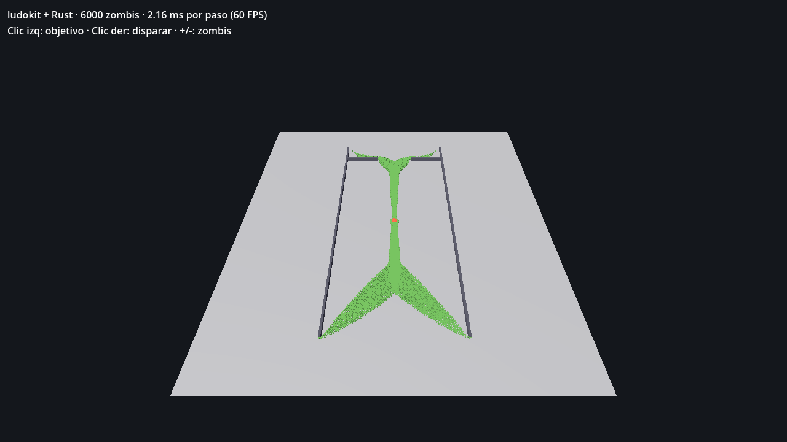

# ludokit para Godot 4 (GDExtension en Rust)

Extensión nativa hecha con [godot-rust (gdext)](https://github.com/godot-rust/gdext) que pone el **núcleo Rust de
alto rendimiento de ludokit** dentro de Godot como clases normales, usables desde **GDScript** (y C#). Compilada
contra la API 4.5: funciona en **Godot 4.5, 4.6 y 4.7** (probada en 4.7.2).



## Clases

| Clase | Para qué | Métodos principales |
|---|---|---|
| `LudoEscena3D` | Disparos y línea de visión en 3D: rayos en lote contra cápsulas/esferas/cajas (grilla + DDA), penetración de paredes | `agregar_capsula/esfera/caja(id, duenio, etiqueta, …)`, `mover_duenio`, `lanzar_rayo(origen, dir, largo, ignorar) → Dictionary`, `lanzar_rayos(PackedVector3Array, PackedVector3Array, largo, ignorar) → PackedFloat32Array`, `definir_material(etiqueta, perdida)`, `disparo_penetrante(…) → Array` |
| `LudoHorda` | Miles de agentes (zombis, súbditos, unidades) con campo de flujo + separación, en paralelo y determinista | `configurar(cols, filas, tile, bloqueo)`, `reglas(vel, acel, radio, separacion)`, `usar_hilos(n)`, `agregar(Vector2)`, `quitar(i)`, `objetivo(Vector2i)`, `paso(dt)`, `posiciones()`, **`escribir_multimesh(multimesh, altura)`**, `distancia_objetivo(pos)` |
| `LudoNiebla` | Niebla de guerra por línea de visión (RTS, MOBA, roguelike) | `configurar(cols, filas, bloqueo)`, `actualizar(PackedVector3Array(x, y, radio)) → PackedByteArray`, `estado(celda)`, `hay_linea(a, b)` |
| `LudoCurva` | Curvas de escalado de ludokit (las mismas que en TypeScript) desde JSON/Dictionary | `cargar(Dictionary) → String (error o "")`, `evaluar(nivel)` |

Convenciones: `duenio = -1` significa "sin dueño" (paredes); `ignorar` es el dueño del tirador; las posiciones de la
horda son `Vector2` en el plano (x → X, y → Z del mundo 3D).

## Medido en Godot 4.7.2 (`prueba.gd`, headless)

- 20 000 rayos contra 2 000 cápsulas en **30 ms** (una sola llamada `lanzar_rayos`).
- 10 000 zombis siguiendo un campo de flujo con separación: **1,2 ms por paso**.
- Demo visual (6 000 zombis, muros, MultiMesh): 60 FPS, 1–2 ms por paso de simulación.

## Compilar y probar

```bash
cd rust/godot
./construir.sh            # o .\construir.ps1 en Windows: cargo build --release + copia a demo/bin/
godot --headless --path demo --script res://prueba.gd    # 12 comprobaciones, sale con código 1 si algo falla
godot --path demo                                         # demo visual (clic izq: objetivo · clic der: disparar · +/-)
godot --path demo -- --captura                            # guarda demo/captura.png a los 8 s y sale
```

Requisitos: Rust 1.94+ y Godot 4.5+. La primera compilación descarga `godot` (gdext) de crates.io.

## Usarla en tu proyecto

1. Compilar (`construir.sh` / `construir.ps1`) para cada plataforma que exportes (Windows `.dll`, Linux/Android
   `.so`, macOS `.dylib`) y copiar las bibliotecas a `res://bin/` de tu proyecto.
2. Copiar `demo/ludokit.gdextension` a tu proyecto (las rutas apuntan a `res://bin/`).
3. Usar las clases desde GDScript:

```gdscript
var horda := LudoHorda.new()

func _ready():
    horda.configurar(160, 160, 1.0, mapa_bloqueo)   # PackedByteArray: 1 = pared
    horda.reglas(5.0, 25.0, 0.8, 4.0)
    horda.usar_hilos(0)                               # todos los núcleos (con pocos agentes usa uno solo)
    for i in 5000: horda.agregar(Vector2(randf() * 40, randf() * 160))
    horda.objetivo(Vector2i(80, 80))                  # recalcular solo cuando el objetivo cambia de celda

func _physics_process(delta):
    horda.paso(delta)                                 # simulación en el paso fijo

func _process(_delta):
    horda.escribir_multimesh($MultiMeshInstance3D.multimesh, 0.5)   # una llamada dibuja todas las instancias
```

```gdscript
# Servidor de un shooter: todos los disparos del tick en una llamada.
var r := escena.lanzar_rayos(origenes, direcciones, 300.0, tiradores)   # n × [id, duenio, etiqueta, distancia]
for i in origenes.size():
    if r[i * 4 + 3] >= 0.0:
        aplicar_danio(int(r[i * 4 + 1]), int(r[i * 4 + 2]))             # dueño y zona (cabeza, torso…)
```

## Reglas de rendimiento

- **Lotes**: `lanzar_rayos` en vez de muchos `lanzar_rayo`; `escribir_multimesh` en vez de `posicion(i)` por agente.
- **Paso fijo**: `paso()` en `_physics_process`; el dibujo en `_process`.
- **Hilos**: `usar_hilos(0)` reparte el cálculo cuando hay miles de agentes; el resultado es el mismo con 1 o N hilos.
- Más contexto (qué mover a Rust y por qué, números medidos): [`docs/RUST.md`](../../docs/RUST.md) y
  [`docs/MOTORES.md`](../../docs/MOTORES.md).

Licencias: este código es parte de ludokit (LLVA 1.0). La dependencia `godot` (gdext) es MPL-2.0 y se descarga de
crates.io al compilar.
